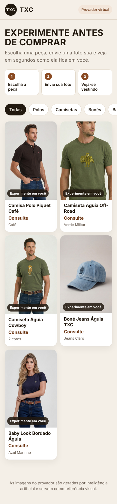
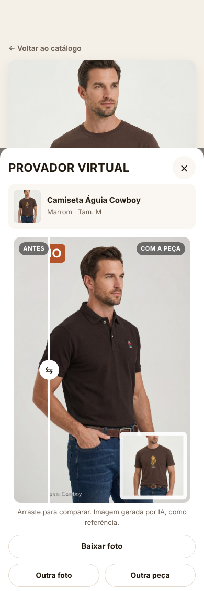
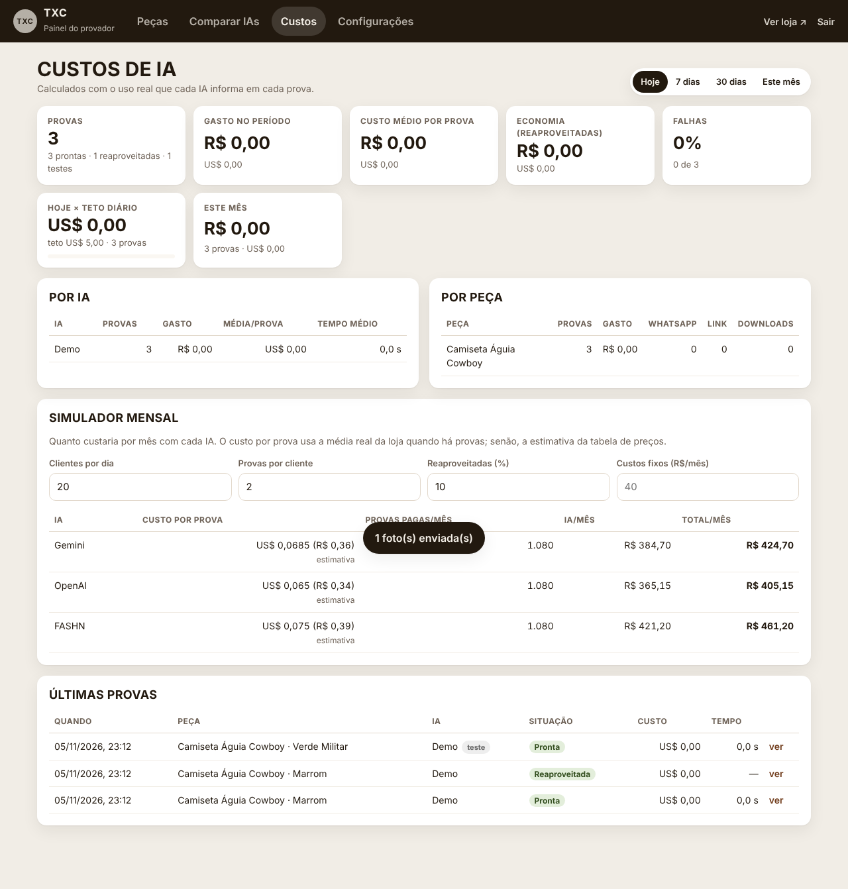

# Provador Virtual TXC

O cliente escolhe uma peça, envia uma foto sua e **se vê vestindo a peça** em uma imagem gerada por IA.
O dono da loja cadastra as peças num painel e acompanha **quanto cada prova custou**.

<p>
  
  
  
</p>

## O que tem

**Para o cliente** (`/`)
- Catálogo com filtros por categoria e uma página para cada peça, com cores e tamanhos.
- **Experimentar em mim:** tira ou envia uma foto, aceita o termo de privacidade e vê o resultado em
  ~10–30 s, com comparação antes/depois.
- Pode **baixar** a foto, chamar a loja no **WhatsApp** (mensagem pronta com peça, cor e tamanho) ou
  abrir o **link de compra**.
- Limite de **5 provas por dia** por aparelho. Repetir a mesma foto com a mesma peça reaproveita o
  resultado: não gasta prova e não custa nada.

**Para o dono** (`/admin`)
- **Peças:** nome, categoria, tipo de prova, gênero, preço, tamanhos, cores, link, descrição e
  "detalhes para a IA".
  - Aceita várias fotos por peça, cada uma ligada a uma cor. A foto marcada com ★ é a que a IA usa.
- **Comparar IAs:** a mesma foto em Gemini, OpenAI e FASHN lado a lado, com custo e tempo de cada uma.
- **Custos:**
  - Gasto do dia e do mês em R$ e US$, custo médio por prova e economia do reaproveitamento.
  - Gasto por IA e por peça, com os cliques no WhatsApp e no link de compra.
  - Simulador mensal e as últimas provas.
- **Configurações:**
  - IA ativa, com modelo e tabela de preços de cada IA (editáveis).
  - Cotação do dólar, limite por cliente, **teto de gasto diário**, prazo para apagar fotos e WhatsApp.

Relatório completo de custos: **[docs/CUSTOS.md](docs/CUSTOS.md)**. Resumo, com dólar a R$ 5,20:

| IA | Custo por prova |
|---|---:|
| Gemini (padrão recomendado) | ~R$ 0,36 |
| OpenAI (qualidade média) | ~R$ 0,34 |
| FASHN | ~R$ 0,39 |
| Demo (sem IA, para testar) | R$ 0 |

## Rodar no seu computador

Precisa do [Node.js](https://nodejs.org) **22.13 ou mais novo**.

```bash
cp .env.example .env      # depois edite o .env: senha do painel e chaves das IAs
npm install
npm start
```

- **Loja:** abra <http://localhost:3000>.
- **Painel:** abra <http://localhost:3000/admin> e entre com a `ADMIN_PASSWORD` do `.env`.
- **Primeira execução:** o sistema cadastra sozinho as 5 peças de exemplo (as fotos enviadas pela loja),
  sem preço. Edite à vontade.
- **IA inicial:** o sistema começa no modo **Demo**, que não usa IA nem custa nada. Ele serve para testar
  o fluxo. Para provas de verdade, configure uma chave (abaixo) e ative a IA em
  **Painel → Configurações**.

## Chaves das IAs

Coloque no `.env`, ou nas variáveis de ambiente da hospedagem. Só preencha as IAs que for usar.

| Variável | Onde conseguir |
|---|---|
| `GEMINI_API_KEY` | <https://aistudio.google.com/apikey> (ative o faturamento no projeto) |
| `OPENAI_API_KEY` | <https://platform.openai.com/api-keys> |
| `FASHN_API_KEY` | <https://app.fashn.ai> → API |

**Primeiro teste com IA real:**
1. Reinicie o servidor.
2. Vá em **Painel → Comparar IAs**.
3. Envie uma foto de teste, escolha uma peça e gere.

Se aparecer erro de modelo ("confira o ID do modelo"), atualize o nome do modelo em
**Configurações → Modelos e preços**. Os fornecedores renomeiam modelos de tempos em tempos.

## Publicar na internet

- **HTTPS é obrigatório.** Em produção os cookies são seguros: sem HTTPS, nem o login do painel nem o
  resultado da prova do cliente funcionam. Railway e Render já dão HTTPS.
- **Senha e segredo são obrigatórios.** Em produção (`NODE_ENV=production`, já definido no Dockerfile) o
  servidor **não sobe** sem `ADMIN_PASSWORD` e `SESSION_SECRET`. Assim o painel nunca fica com uma senha
  padrão.

**Railway**
1. Crie um projeto a partir deste repositório. O `Dockerfile` é detectado.
2. Adicione um **Volume** montado em `/data`.
3. Em *Variables*, defina `ADMIN_PASSWORD`, `SESSION_SECRET` (um texto longo aleatório) e as chaves das
   IAs.
4. Gere um domínio em *Settings → Networking*.

**Render**
1. Crie um *Web Service* com Docker a partir do repositório.
2. Adicione um **Disk** montado em `/data`.
3. Defina as mesmas variáveis do Railway.

**VPS (Docker)**

```bash
docker build -t provador-txc .
docker run -d --name provador -p 3000:3000 -v provador-data:/data \
  -e ADMIN_PASSWORD=... -e SESSION_SECRET=... -e GEMINI_API_KEY=... provador-txc
```

Coloque um proxy com HTTPS na frente (ex.: Caddy ou Nginx).

**Outras variáveis**
- `TRUST_PROXY`: quantos proxies há na frente do app. O padrão é `1` em produção. Ele serve para ler o
  IP real do cliente e aplicar o limite por IP.
- `PORT`: o padrão é `3000`.
- `DATA_DIR`: o padrão é `./data`, e `/data` no Docker.

**Backup:** tudo fica em `DATA_DIR`: o banco `app.db` e as pastas de fotos. Copie essa pasta.

## Privacidade (LGPD)

- O cliente precisa aceitar o termo antes de enviar a foto.
- Fotos de clientes **nunca ficam públicas**.
- Fotos e resultados são **apagados automaticamente** após 24 h (configurável). Fica só o registro de
  custo, sem imagem.
- O IP é guardado apenas como hash, para o limite diário.

## Desenvolvimento

```bash
npm test         # testes automatizados (Node test runner)
npm run smoke    # teste no navegador (Playwright): loja + painel em modo Demo, salva capturas de tela
```

Estrutura:
- `server.js`: ponto de entrada.
- `src/`: servidor.
  - `providers/`: uma conexão por IA.
  - `tryon-service.js`: limite, cache, teto e fila.
  - `pricing.js`: custos.
- `public/`: loja; `public/admin/`: painel.
- `seed/images/`: fotos das peças de exemplo.

Design e plano: `docs/superpowers/`.
